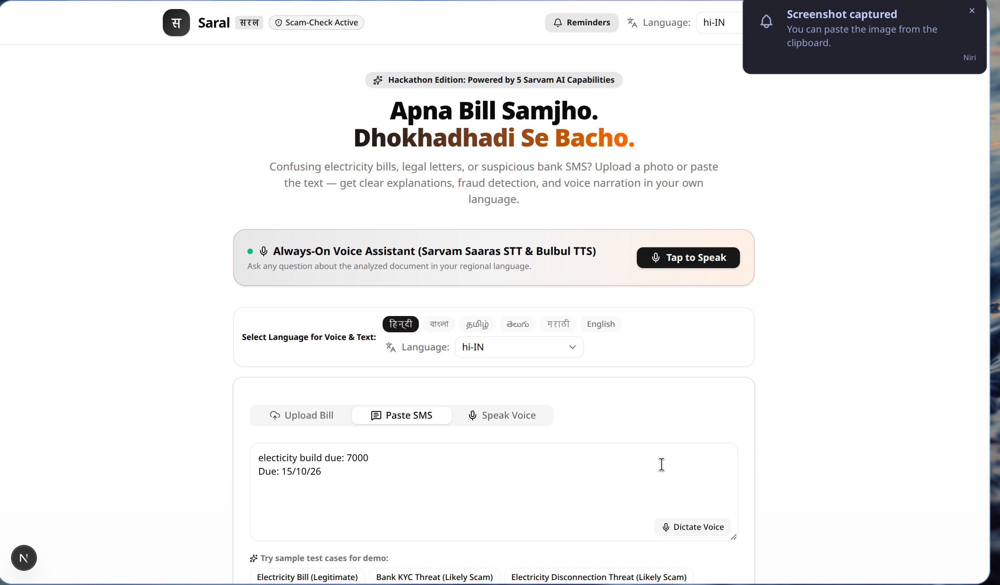
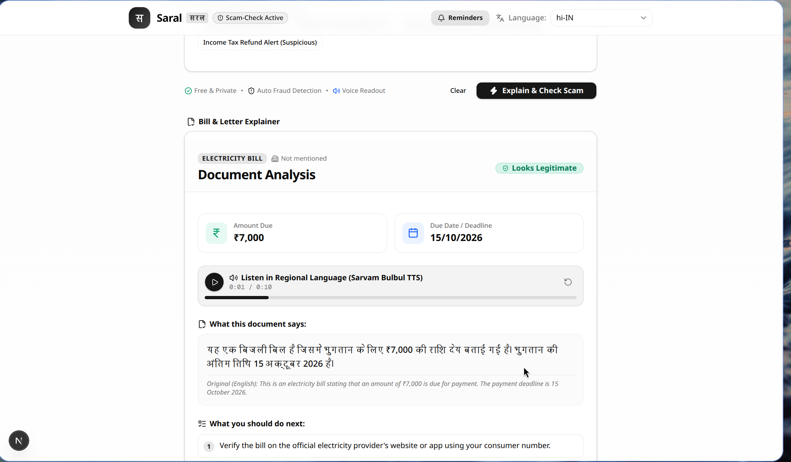
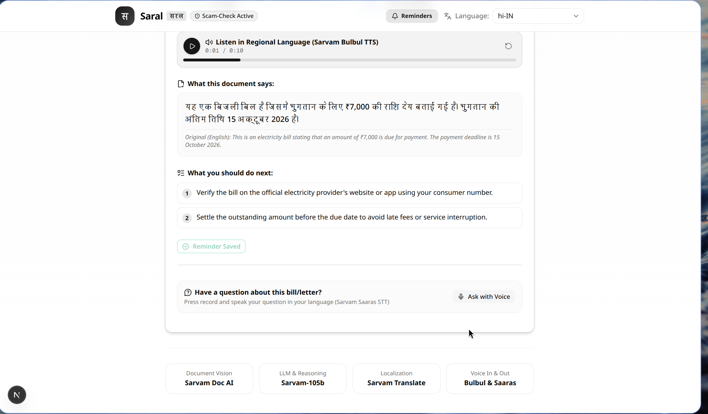
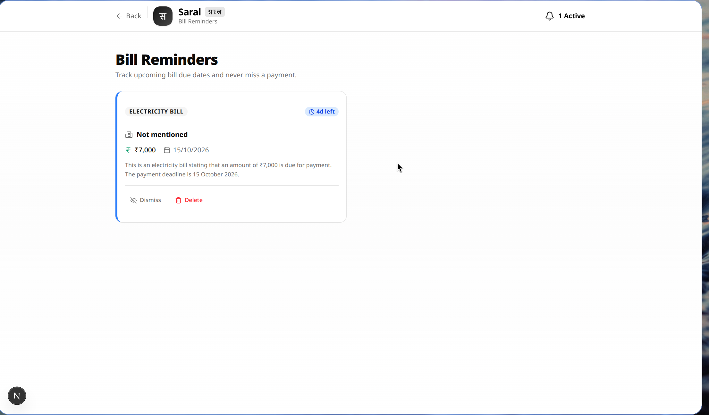

# Saral (सरल) — Bill & Letter Explainer
> "Apna Bill Samjho, Dhokhadhadi Se Bacho"  
> An AI-powered explainer, fraud detector, and bill reminder system for bills, legal notices, and SMS alerts in Indian languages, powered by Sarvam AI.

---

## Architecture

```
User (Browser)
   │
   ├── Uploads Bill/Notice (PDF/Image)  OR  Pastes SMS/Text
   │
   ▼
[FastAPI Backend] ───────► 1. Sarvam Doc AI (Digitise & Extract)
   │
   ├────────────────────► 2. Sarvam LLM (sarvam-105b-conversations with JSON Schema)
   │                         • Document Type & Issuer
   │                         • Amount Due & Due Date
   │                         • Plain-Language Summary
   │                         • Action Items Checklist
   │                         • Scam Risk Flag (normal | suspicious | likely_scam)
   │
   ├────────────────────► 3. Sarvam Translate (Translate to User's Regional Language)
   │
   ├────────────────────► 4. Sarvam Bulbul TTS (Generate Voice Narration)
   │
   ├────────────────────► 5. SQLite Reminders Database (Auto-saves legitimate bill deadlines)
   │
   ▼
[Next.js + shadcn UI] ◄── Returns JSON + Audio Base64 + Reminder Status
   │
   ├── Voice Assistant (Saaras STT) ──► Asks follow-up questions via microphone
   └── Dedicated Reminders Page ──────► View, manage, and track upcoming due dates
```

---

## Features

- **Document Extraction (Sarvam Doc AI)**: Digitizes receipts, utility bills, notices, and letters from images and multi-page PDFs.
- **Scam and Fraud Detection**: Identifies extortion threats, urgent 24-hour ultimatums, unverified UPI IDs, and phishing links. Classifies as `normal`, `suspicious`, or `likely_scam`.
- **Regional Language Translation (Sarvam Translate)**: Translates summaries and explanations into 10+ Indian languages (Hindi, Bengali, Tamil, Telugu, Marathi, Gujarati, Kannada, Punjabi, etc.).
- **Voice Readout (Sarvam Bulbul TTS)**: Synthesizes high-fidelity regional speech so users can listen to explanations aloud.
- **Voice Follow-up Assistant (Sarvam Saaras STT)**: Allows hands-free spoken queries with automatic speech transcription.
- **Bill Reminders System (SQLite)**: Automatically detects and registers valid payment deadlines into an embedded SQLite database. Includes a dedicated dashboard at `/reminders` with real-time urgency sorting (Overdue, Due Today, Due Soon).

---

## Screenshots & Walkthrough

### 1. Document Input & Always-On Voice Assistant
Upload a bill photo or PDF, paste SMS text, or speak directly to the voice assistant. The regional language selector supports Hindi, Bengali, Tamil, Telugu, Marathi, and more.



### 2. Document Analysis & Regional Audio Readout
Structured extraction of document type, issuer, amount due, and due date alongside fraud verification ("Looks Legitimate"), plain-language regional summary, and audio narration powered by Sarvam Bulbul TTS.



### 3. Action Items Checklist, Auto-Saved Reminder & Voice Q&A
Actionable next steps, automatic persistence of verified payment deadlines ("Reminder Saved"), and an interactive microphone to ask spoken follow-up questions in your language via Sarvam Saaras STT.



### 4. Dedicated Bill Reminders Dashboard
Centralized dashboard at `/reminders` tracking upcoming payment deadlines with countdown badges (e.g., "4d left", "Due today", "Overdue"), urgency color-coding, and dismiss/delete controls.



---

## Quick Start

### 1. Prerequisites
- Python 3.10+
- Node.js 18+
- Sarvam AI API Key ([dashboard.sarvam.ai](https://dashboard.sarvam.ai))

### 2. Configure API Key
```bash
cp backend/.env.example backend/.env
# Open backend/.env and set:
# SARVAM_API_KEY=your_actual_sarvam_api_key
```

### 3. Run Backend (FastAPI)
```bash
cd backend
python3 -m venv venv
./venv/bin/pip install -r requirements.txt
./venv/bin/uvicorn app.main:app --reload --port 8000
```
Backend will be live at `http://localhost:8000`. Interactive API docs at `http://localhost:8000/docs`.

### 4. Run Frontend (Next.js + shadcn/ui)
```bash
cd frontend
npm install
npm run dev
```
Frontend will be live at `http://localhost:3000`.

*(Alternatively, use `make dev` from the repository root to run both concurrently).*

---

## Reminders System

The platform includes an embedded SQLite database (`backend/data/reminders.db`) for tracking bill payment deadlines.

### Auto-Save Mechanism
When a document analysis produces a legitimate assessment (`risk_level: "normal"`) and contains a valid deadline, it is automatically saved to the database. Users can also manually save reminders from the analysis card.

### Reminders Dashboard
Visit `http://localhost:3000/reminders` or click the **Reminders** button in the header. The page provides:
- Urgency badges with days remaining calculation (Overdue, Due Today, X days left).
- Color-coded borders based on proximity to due date.
- One-click dismiss and delete controls.

### Reminders API Reference
- `GET /api/reminders?include_dismissed=false` — Fetch active reminders sorted by urgency.
- `POST /api/reminders` — Save a bill reminder (form fields: `document_type`, `issuer`, `amount_due`, `due_date`, `summary`, `risk_level`).
- `PATCH /api/reminders/{id}/dismiss` — Hide a reminder from the active list.
- `DELETE /api/reminders/{id}` — Permanently remove a reminder.

---

## Test Scenarios

Use the built-in quick presets on the **Paste SMS/Text** tab:

| Scenario | Input Type | Expected Risk Badge | Audio Voice |
|---|---|---|---|
| **BSES Electricity Bill** | Document or Text | **Looks Legitimate** | Explains bill, subsidy, and due date in chosen language. Auto-saved to reminders. |
| **SBI YONO Block Threat** | SMS | **Likely Scam Detected** | Flags urgent 24h deadline, unofficial URL, and fake account block threat. |
| **Electricity Cutoff Threat** | SMS | **Likely Scam Detected** | Flags informal officer phone number and personal GPay transfer request. |
| **Income Tax Refund Alert** | SMS/Text | **Suspicious / Caution** | Warns against UPI PIN requests on non-government domain. |

---

## Project Structure

```
servam-ps/
├── backend/
│   ├── app/
│   │   ├── main.py              # FastAPI app, routes, reminders endpoints, auto-save
│   │   ├── pipeline.py          # 5-step Sarvam AI pipeline (sarvam-105b-conversations)
│   │   ├── db.py                # SQLite reminders persistence & date parser
│   │   ├── prompts.py           # Scam detection indicators & JSON schemas
│   │   ├── sarvam_client.py     # Lazy singleton SarvamAI client
│   │   └── schemas.py           # Pydantic models for validation & serialization
│   ├── data/                    # SQLite database storage (git-ignored)
│   ├── requirements.txt         # sarvamai, fastapi, uvicorn, python-multipart
│   ├── .env.example
│   └── Makefile
├── frontend/
│   ├── src/
│   │   ├── app/
│   │   │   ├── page.tsx         # Main interactive dashboard
│   │   │   ├── layout.tsx       # Root layout & branding metadata
│   │   │   └── reminders/
│   │   │       └── page.tsx     # Dedicated bill reminders dashboard
│   │   ├── components/
│   │   │   ├── upload-zone.tsx       # Drag-and-drop file upload & SMS paste
│   │   │   ├── analysis-card.tsx     # Results, scam alerts, save reminder button
│   │   │   ├── audio-player.tsx      # Inline audio player for Bulbul TTS
│   │   │   ├── risk-badge.tsx        # Color-coded fraud indicator badge
│   │   │   ├── voice-recorder.tsx    # Follow-up audio recording (Saaras STT)
│   │   │   ├── voice-assistant-bar.tsx # Hands-free voice assistant bar
│   │   │   ├── language-selector.tsx # Regional language picker (12+ languages)
│   │   │   └── loading-skeleton.tsx  # Dynamic pipeline loading animation
│   │   ├── lib/
│   │   │   ├── api.ts           # Fetch API wrapper with reminders methods
│   │   │   ├── constants.ts     # Language options & sample presets
│   │   │   └── types.ts         # TypeScript interfaces
│   │   └── components/ui/       # shadcn/ui component primitives
│   ├── package.json
│   └── next.config.ts
├── docs/
│   └── images/                  # UI walkthrough screenshots
├── Makefile
└── README.md
```
